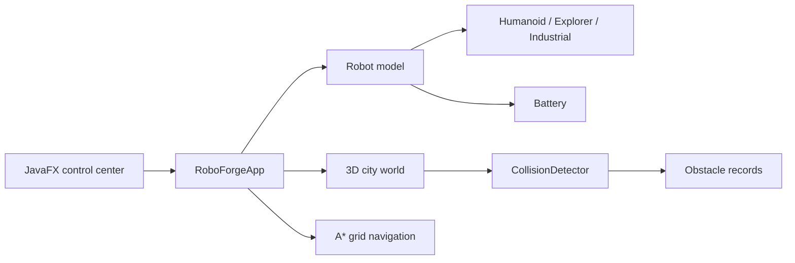

# RoboForge

<p align="center">
  <strong>Explore, control, and navigate a 3D robot city built with JavaFX.</strong><br/>
  An object-oriented simulation of robot behaviors, telemetry, cargo handling, scanning, and collision-aware navigation.
</p>

<p align="center">
  
  
  
  
</p>

---

## Overview

RoboForge is a desktop JavaFX application that places three robot types inside a fixed-camera 3D city. It demonstrates object-oriented modeling, JavaFX scene composition, robot-specific capabilities, collision detection, resource management, animation, and grid-based pathfinding.

The project is designed as an interactive learning platform rather than a hardware-control system. All city objects, sensor readings, cargo, battery usage, and navigation results are simulated locally.

## What it does

- **Three robot types:** Humanoid, Explorer, and Industrial
- **3D city simulation:** JavaFX primitive geometry with a structured, fixed-camera environment
- **Robot control:** Movement, strafing, rotation, stopping, speed adjustment, and position reset
- **Environment awareness:** Building collision detection and nearby obstacle status
- **Explorer automation:** Multi-segment automatic exploration through the city
- **Scanning:** Simulated sector and cargo detection with animated Explorer sensors
- **Cargo handling:** Industrial and Humanoid robots can pick up and drop supply crates
- **Robot animation:** Industrial arm movement during cargo operations
- **Route planning:** A* navigation on a 20-unit grid with collision checks
- **Telemetry:** Position, mode, battery, sensor, cargo, and activity status
- **Battery simulation:** Energy use for movement, rotation, and patrols, with recharge support

## Architecture



### Object-oriented design

| Component | Responsibility |
| --- | --- |
| `Robot` | Shared movement, heading, mode, speed, and battery behavior |
| `HumanoidRobot` | General-purpose robot with cargo handling |
| `ExplorerRobot` | Automated exploration and environment scanning |
| `IndustrialRobot` | Cargo handling with an animated industrial arm |
| `Movable` | Movement and rotation contract |
| `Scannable` | Environment scanning contract |
| `ObjectHandler` | Cargo pickup and drop contract |
| `CollisionDetector` | Finds obstacles that block a proposed position |
| `Obstacle` | Immutable obstacle geometry and clearance rules |
| `RoboForgeApp` | JavaFX scene, controls, animation, telemetry, and navigation |

## Requirements

- [JDK 21](https://adoptium.net/)
- [Apache Maven](https://maven.apache.org/) 3.9 or later
- A desktop environment capable of running JavaFX

Verify the installations:

```bash
java -version
mvn -version
```

## Getting started

Clone the repository and launch the application:

```bash
git clone https://github.com/Muhammad-Tayyab-official/RoboForge.git
cd RoboForge
mvn clean javafx:run
```

Maven downloads the JavaFX dependencies and launches `com.roboforge.app.RoboForgeApp`.

### IntelliJ IDEA

1. Open the directory containing `pom.xml`.
2. Select **JDK 21** as the project SDK.
3. Reload the Maven project.
4. Run the Maven goal `clean javafx:run`.

## Controls

| Action | Keyboard | Control panel |
| --- | --- | --- |
| Move forward | `W` / `Up` | Forward |
| Move backward | `S` / `Down` | Backward |
| Strafe left/right | `A` / `Left`, `D` / `Right` | Left / right |
| Rotate | `Q`, `E` | Turn left / right |
| Stop movement | `Space` | Stop |
| Scan surroundings | — | Scan surroundings |
| Pick up cargo | — | Pick cargo |
| Drop cargo | — | Drop cargo |
| Recharge | — | Recharge battery |
| Explore automatically | — | Auto explore |
| Reset position | — | Reset robot position |
| Navigate | — | Enter X/Z and select **Plan route & navigate** |

### Robot-specific actions

- **Auto Explore** requires the **Explorer Robot**.
- **Pick Cargo** and **Drop Cargo** are available to **Humanoid** and **Industrial** robots.
- Destination coordinates are snapped to the 20-unit navigation grid.
- Switching robots resets the selected robot to the city start point and is disabled while cargo is carried.

## Project structure

```text
src/
└── main/
    └── java/com/roboforge/
        ├── app/
        │   └── RoboForgeApp.java
        ├── model/
        │   ├── Robot.java
        │   ├── HumanoidRobot.java
        │   ├── ExplorerRobot.java
        │   ├── IndustrialRobot.java
        │   ├── Battery.java
        │   ├── Movable.java
        │   ├── Scannable.java
        │   └── ObjectHandler.java
        └── simulation/
            ├── CollisionDetector.java
            └── Obstacle.java
```

## Development

Compile without launching the application:

```bash
mvn clean compile
```

The city geometry and robot scene node remain separate so robot movement never transforms the environment. The playable area is bounded to the camera-framed city, and A* navigation uses the central drivable grid from `X -300..300` and `Z -150..150`.

## Limitations

- This is a software simulation, not hardware-control software.
- Visual assets use JavaFX primitive shapes rather than imported 3D models.
- Sensor readings represent simulated city objects, not physical sensor data.
- The Industrial robot arm uses simplified joint animation rather than full inverse kinematics.

## License

Released under the [MIT License](LICENSE).
